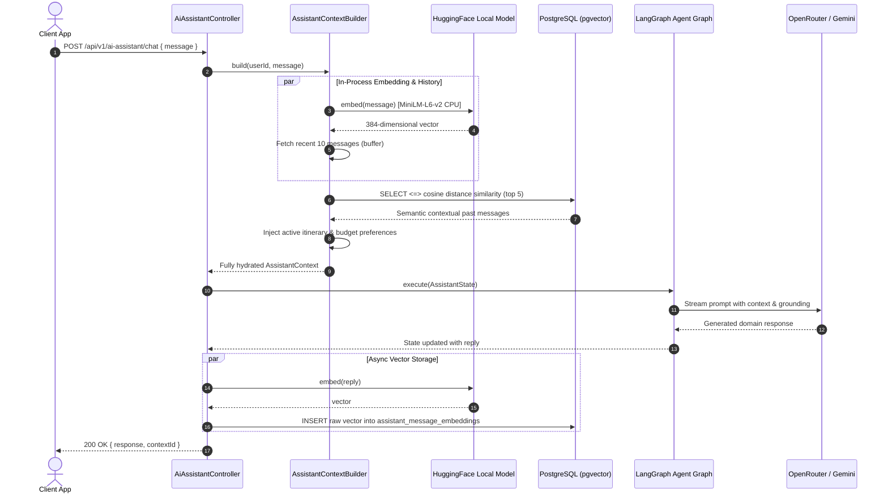
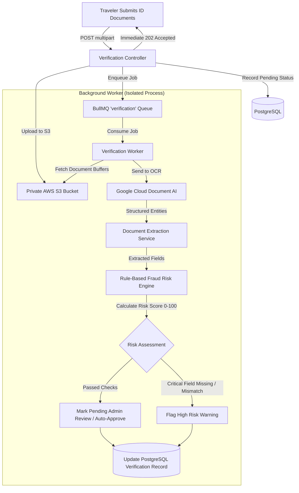
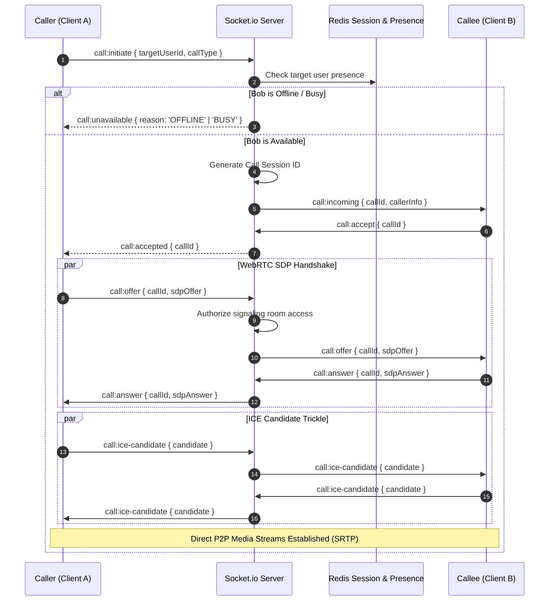

```mermaid
graph TD
    subgraph Presentation_Layer ["Presentation Layer (Ports & Transport)"]
        HTTP[Express 5 REST API]
        SOCK[Socket.io Signaling & Chat]
        VAL[Zod Request Validation]
        ERR[Centralized Global Error Mapper]
        METRIC[Prometheus Metrics Middleware]
    end

    subgraph Application_Layer ["Application Layer (Use Cases & Orchestration)"]
        UC_AUTH[Auth & Session Use Cases]
        UC_GEO[Geospatial Matchmaking Use Cases]
        UC_AI[LangGraph Travel Agent Use Cases]
        UC_VERIF[Async Verification Use Cases]
        UC_COMM[Community Trip Booking Use Cases]
        PORTS[Service & Repository Interface Contracts]
    end

    subgraph Domain_Layer ["Domain Layer (Core Business Rules)"]
        ENT_USER[User & Profile Aggregates]
        ENT_TRIP[Trip & Community Aggregates]
        VAL_OBJ[Domain Enums & Value Objects]
        DOM_ERR[Domain Business Errors]
    end

    subgraph Infrastructure_Layer ["Infrastructure Layer (Adapters & External Systems)"]
        REPO_PG[Prisma / PostgreSQL Adapter]
        VEC_PG[pgvector Cosine Search]
        GEO_PG[PostGIS Spatial Engine]
        CACHE_REDIS[Redis Caching & Presence Engine]
        QUEUE_BULL[BullMQ Asynchronous Job Queues]
        AI_HF[HuggingFace Local Embeddings]
        AI_DOC[Google Cloud Document AI]
        S3_STORAGE[AWS S3 Presigned Storage Adapter]
        PAY_GATEWAY[Razorpay Cryptographic Verification]
    end

    HTTP --> VAL
    VAL --> UC_AUTH
    VAL --> UC_GEO
    VAL --> UC_COMM
    SOCK --> UC_AI
    HTTP --> METRIC

    UC_AUTH --> PORTS
    UC_GEO --> PORTS
    UC_AI --> PORTS
    UC_VERIF --> PORTS
    UC_COMM --> PORTS

    PORTS --> ENT_USER
    PORTS --> ENT_TRIP
    PORTS --> DOM_ERR

    REPO_PG -.->|Implements| PORTS
    GEO_PG -.->|Implements| PORTS
    VEC_PG -.->|Implements| PORTS
    CACHE_REDIS -.->|Implements| PORTS
    QUEUE_BULL -.->|Implements| PORTS
    AI_HF -.->|Implements| PORTS
    AI_DOC -.->|Implements| PORTS
    S3_STORAGE -.->|Implements| PORTS
    PAY_GATEWAY -.->|Implements| PORTS
```

<div align="center">

# 🌐 Voymate Core Engine (`Server`)

### High-Performance, Distributed Backend for Real-Time Solo Traveler Discovery, AI Travel Assistance & Verified Community Expeditions

[](https://www.typescriptlang.org/)
[](https://nodejs.org/)
[](https://expressjs.com/)
[](https://www.postgresql.org/)
[](https://www.prisma.io/)
[](https://redis.io/)
[](https://www.docker.com/)
[](https://github.com/features/actions)
[](https://www.doppler.com/)
[](https://aws.amazon.com/)
[](https://socket.io/)
[](https://prometheus.io/)

<p align="center">
  <b>Built with Clean Architecture, Domain-Driven Design (DDD), PostGIS Geospatial Indexing, Local HuggingFace In-Process Vector Embeddings, LangGraph Stateful Agentic Graphs, BullMQ Distributed Queues, Doppler Secret Ops, Multi-Stage Docker, and Zero-SSH AWS SSM CI/CD.</b>
</p>

---

</div>

## 📌 Executive Architectural Summary

The **Voymate Core Server** is an enterprise-grade backend engineered to solve the complex distributed systems and real-time synchronization challenges of a modern social travel ecosystem.

Rather than relying on monolithic, ad-hoc MVC patterns, this system is architected around **Domain-Driven Design (DDD)** and **Clean / Hexagonal Architecture (Ports and Adapters)** using strict dependency inversion, typed dependency injection via `TSyringe`, and immutable domain boundaries.

### Key Engineering Highlights:

- **Zero Business Logic Leaks**: Domain entities and use cases remain strictly isolated from external libraries, Express HTTP abstractions, and Prisma database models.
- **Geospatial Proximity Matchmaking**: Custom PostGIS spatial queries (`geography(Point, 4326)`) using `ST_DWithin` and `ST_Distance` with spatial indexing to discover active solo travelers on the road within sub-kilometer precision.
- **Edge AI & Vector Semantic Retrieval (RAG)**: In-process vector embedding generation via `@huggingface/transformers` (`all-MiniLM-L6-v2`) on CPU coupled with PostgreSQL `pgvector` cosine distance queries (`<=>`), eliminating external embedding API costs and latency.
- **Stateful Agentic Workflows**: Multi-node state machine orchestration via `@langchain/langgraph` integrating user profile context, active itineraries, and vector conversation history.
- **Asynchronous Document AI & Verification Pipeline**: Distributed task processing via BullMQ and Redis to execute OCR extraction with Google Cloud Document AI and rule-based fraud risk scoring without blocking event loops.
- **Full-Duplex Real-Time Fabric**: WebRTC audio/video signaling state machine and Socket.io chat with multi-socket presence tracking and distributed room authorization.
- **Doppler Secret Management Architecture**: Zero plaintext secrets stored on disk or committed to source control; runtime secret injection via Doppler CLI across local development and production Docker containers.
- **Multi-Stage Containerization & Custom Database**: Multi-stage lean Docker production image (`node:22-bookworm-slim`) paired with a custom PostgreSQL container unifying `pgvector/pgvector:0.8.6` and `postgresql-15-postgis-3`.
- **Enterprise CI/CD & Zero-SSH Automated Deployment**: Fully automated GitHub Actions pipeline validating branch naming, conventional commits, linting, and strict TypeScript compilation, followed by keyless AWS OIDC role assumption, ECR container publishing, and zero-SSH remote execution on EC2 via **AWS Systems Manager (SSM)**.
- **Production-Grade Telemetry**: Prometheus metrics middleware exporting active request gauges, latency histograms, and error counters to `/metrics`.

---

## 🏛️ System Architecture & Layer Boundaries

The codebase enforces strict unidirectional dependency flow from presentation to domain:

```
[Presentation Layer]  -->  [Application Layer]  -->  [Domain Layer]
  (Controllers, Routes,      (Use Cases, DTOs,         (Entities, Value Objects,
   Socket Handlers, Zod)      Ports / Interfaces)       Domain Errors, Enums)
         |                           ^                          ^
         |                           |                          |
         +------------------- [Infrastructure Layer] -----------+
                              (Prisma Repositories, Redis Cache,
                               BullMQ Queues, AWS S3, LangGraph)
```



---

## ⚡ Core Engineering Subsystems

### 1. Geospatial Traveler Discovery Engine (PostGIS)

Finding fellow solo travelers within an adjustable radius requires sub-second execution on high-density coordinate tables without table scans.

- **Spatial Modeling**: Columns utilize `geography(Point, 4326)` for ellipsoidal calculations on Earth's curved surface.
- **Index Optimization**: Built with spatial GiST indexes over coordinates.
- **Raw Query Execution**:
  ```sql
  SELECT u.id, u.full_name, l.current_city,
         ST_Distance(l.coordinates, ST_SetSRID(ST_MakePoint($1, $2), 4326)::geography) / 1000 AS distance_km
  FROM users u
  JOIN user_locations l ON u.id = l.user_id
  WHERE u.account_status = 'ACTIVE'
    AND u.id != $3
    AND ST_DWithin(l.coordinates, ST_SetSRID(ST_MakePoint($1, $2), 4326)::geography, $4)
  ORDER BY distance_km ASC;
  ```

---

### 2. Hybrid RAG & Stateful AI Travel Agent (LangGraph + pgvector)

Rather than passing an entire unbounded chat transcript to an LLM, the AI subsystem combines semantic vector retrieval with localized memory and itinerary metadata:



- **Local Feature Extraction**: Utilizes `@huggingface/transformers` to run `Xenova/all-MiniLM-L6-v2` locally inside Node.js, yielding 384-dimensional normalized embeddings with zero external HTTP latency.
- **Vector Indexing**: Native SQL queries using `<=>` (cosine distance operator) partitioned by `conversation_id`.
- **Stateful Graph**: Defined via `StateGraph(AssistantState)` with dedicated prompt formatting, contextual injection, and validation nodes.

---

### 3. Distributed Document AI & Verification Pipeline (BullMQ + Redis)

Government-issued ID verification (passports, Aadhaar, driving licenses) is CPU- and I/O-intensive. Blocking the HTTP thread during OCR leads to timeout cascades under load.



- **BullMQ Queue Management**: Configured with automatic retries, exponential backoff, and dead-letter queue (DLQ) support.
- **Fraud Risk Engine**: Evaluates full name fuzzy matching, document validity dates, required side codes (front/back), and applies calibrated penalties against the 100-point trust score.

---

### 4. Real-Time WebRTC Video & Audio Signaling Fabric

P2P WebRTC calls require a fault-tolerant signaling backplane to exchange Session Description Protocol (SDP) offers, answers, and ICE candidates.



- **Distributed Presence**: Multi-socket mapping in Redis allows users to connect from multiple tabs/devices without false "offline" states (`isFirstSocket` detection).
- **Signaling Security**: `IAuthorizeSignalingUseCase` verifies both participants belong to an active, authorized call before relaying SDP payloads.

---

### 5. Community Expedition Booking & Payment Concurrency Engine

Paid community adventures experience sudden booking spikes when slots are released.

- **Race Condition Prevention**: Prevents overbooking beyond `maxCapacity` through strict pre-condition checks, database constraint guards, and atomic joined count increments.
- **Razorpay Integration**: Two-phase checkout flow:
  1. `create-razorpay-order.usecase`: Generates an official payment order with amounts locked in paise.
  2. `verify-razorpay-booking.usecase`: Cryptographically validates the HMAC-SHA256 signature using `crypto.createHmac('sha256', secret).update(orderId + "|" + paymentId)`.
- **Digital Pass Generation**: Generates deterministic alphanumeric booking codes (`VM-<SLUG>-<RANDOM>`) for check-in verification.

---

## 🚢 DevOps, CI/CD, Containerization & Secret Management

A key engineering differentiator of Voymate is its production deployment automation, secrets governance, and container orchestration:

```mermaid
flowchart LR
    subgraph Development ["Local Workstation"]
        DEV[Developer Commit] --> GIT_HOOKS[Husky & Lint-Staged]
        GIT_HOOKS --> GIT_PUSH[git push origin main]
    end

    subgraph GitHub_Actions ["GitHub Actions CI/CD Pipeline"]
        GIT_PUSH --> CI_VAL[Branch Name & Commit Linter]
        CI_VAL --> CI_BUILD[Node 22, Prisma Gen, ESLint, tsc --noEmit]
        CI_BUILD --> OIDC[AWS IAM OIDC Role Assume]
        OIDC --> ECR_PUSH[Build Dockerfile.prod & Push to Amazon ECR]
        ECR_PUSH --> SSM_DISPATCH[AWS SSM Send-Command to EC2]
    end

    subgraph Production_EC2 ["Amazon EC2 Production Host"]
        SSM_DISPATCH --> EXEC_DEPLOY[/home/ubuntu/deploy.sh]
        EXEC_DEPLOY --> ECR_PULL[Pull Latest Docker Image from ECR]
        EXEC_DEPLOY --> DOCKER_COMPOSE[docker compose -f docker-compose.prod.yml up -d]
        DOPPLER_VAULT[(Doppler Secret Vault)] -.->|doppler run runtime injection| DOCKER_CONTAINER[Voymate API Container]
        DOCKER_COMPOSE --> DOCKER_CONTAINER
    end
```

### 1. Enterprise CI/CD Pipeline (`.github/workflows/ci.yml`)

The server employs a fully automated, three-stage continuous integration and delivery pipeline:

1. **Quality Gates & Governance (`build-and-check`)**:
   - **Branch Name Enforcement**: Pull requests are strictly validated against semantic patterns (`^(feature|bugfix|hotfix|chore|release)\/[A-Z]+-[0-9]+-[a-z0-9-]+$`).
   - **Conventional Commit Linter**: Every commit in the PR branch is validated against conventional commit standards (`feat:`, `fix:`, `refactor:`, `chore:`, etc.).
   - **Automated Verification**: Automatically runs `npm ci`, `npx prisma generate`, `npm run format:check`, `npm run lint`, `npx tsc --noEmit`, and `npm run build`.
2. **Container Build & Registry Publishing (`build-and-push`)**:
   - Uses keyless **AWS IAM OIDC Federation** (`aws-actions/configure-aws-credentials`) to eliminate static long-lived AWS secret access keys in GitHub Secrets.
   - Builds the production container using `Dockerfile.prod` and pushes both immutable SHA tags (`${{ github.sha }}`) and `latest` to **Amazon Elastic Container Registry (ECR)**.
3. **Zero-SSH Automated Deployment (`deploy`)**:
   - Rather than exposing SSH port 22 to the public internet, deployment is orchestrated via **AWS Systems Manager (SSM)**.
   - Dispatches `AWS-RunShellScript` invoking `/home/ubuntu/deploy.sh`, polls execution status, streams STDOUT/STDERR logs back to the GitHub Actions console, and verifies deployment health.

---

### 2. Doppler Secret Management Architecture

Storing credentials in plaintext `.env` files is a major security vulnerability in production environments. Voymate implements **Doppler Secret Ops**:

- **Centralized Vault**: All database credentials, JWT secrets, third-party API keys (Razorpay, Twilio, Google Document AI, AWS S3) are stored in Doppler's encrypted secret vault.
- **Process Injection**: The production image installs the Doppler CLI during multi-stage build. The container boots via:
  ```dockerfile
  CMD ["doppler", "run", "--", "npm", "start"]
  ```
- **Zero Plaintext Secrets**: Secrets are injected directly into process memory (`process.env`) at container launch, leaving zero plaintext configuration artifacts on disk.
- **Environment Parity**: Developers use `doppler run -- npm run dev` locally, ensuring local environments are synchronized with production secrets without manual file sharing.

---

### 3. Containerization (Docker & Docker Compose)

The backend is fully containerized for both local development and production isolation:

- **Multi-Stage Production Build (`Dockerfile.prod`)**:
  - **Stage 1 (Builder)**: `node:22-bookworm-slim` installs dev dependencies, Doppler CLI, compiles TypeScript, and generates Prisma client models.
  - **Stage 2 (Production)**: Clean `node:22-bookworm-slim` base copying only compiled JS (`dist/`), production dependencies (`npm ci --omit=dev`), Prisma schemas/migrations, and the Doppler CLI. Yields a lightweight, hardened container image.
- **Custom Geospatial + Vector Database (`postgres/Dockerfile`)**:
  - Builds from `pgvector/pgvector:0.8.6-pg15-bookworm`.
  - Installs `postgresql-15-postgis-3` and `postgresql-15-postgis-3-scripts`.
  - Automatically initializes both `postgis` and `vector` extensions via initialization hooks, providing a single consolidated datastore for relational, geospatial, and semantic vector operations.
- **Docker Compose Topology**:
  - `docker-compose.yml`: Local orchestrator wiring the API (with Chrome DevTools debugging on port `9229`), PostgreSQL (PostGIS + pgvector), and Redis with healthcheck dependencies (`pg_isready`).
  - `docker-compose.prod.yml`: Production orchestrator pulling immutable ECR images and injecting `DOPPLER_TOKEN`.

---

## 📂 Project Directory Structure

```
Server/
├── .github/                       # GitHub Actions CI/CD Workflows
│   └── workflows/
│       └── ci.yml                 # Automated Quality Gates, ECR Push & SSM Deploy
│
├── postgres/                      # Custom PostgreSQL Docker Image
│   ├── Dockerfile                 # Unified pgvector + PostGIS 3 Image Definition
│   └── init-extensions.sql        # Automated CREATE EXTENSION Initializer
│
├── src/
│   ├── application/               # Application Layer (Use Cases & Orchestration)
│   │   ├── dtos/                  # Request / Response Data Transfer Objects
│   │   ├── interfaces/            # Dependency Inversion Ports (Contracts)
│   │   │   ├── repositories/      # Repository Interfaces
│   │   │   ├── services/          # External Service Interfaces
│   │   │   └── use-cases/         # Use Case Interfaces
│   │   └── use-cases/             # Application Use Case Implementations
│   │
│   ├── config/                    # Environment & Process Configuration
│   │   └── env.config.ts          # Validated Environment Config
│   │
│   ├── domain/                    # Domain Layer (Pure Enterprise Rules)
│   │   ├── entities/              # Domain Aggregates & Models
│   │   ├── enums/                 # Domain Enums (Status, Types, Roles)
│   │   └── errors/                # Typed Domain Business Exceptions
│   │
│   ├── infrastructure/            # Infrastructure Layer (Secondary Adapters)
│   │   ├── ai/                    # LangGraph State Machine & AI Builders
│   │   ├── database/              # Persistence Engine
│   │   │   ├── repositories/      # Concrete Prisma Repositories
│   │   │   └── schema/models/     # Modular Multi-File Prisma Schemas
│   │   ├── di/                    # Dependency Injection (TSyringe Container & Tokens)
│   │   ├── jobs/                  # BullMQ Queues, Processors & Background Workers
│   │   ├── logging/               # Winston Daily Rotate Logger & Prometheus Metrics
│   │   ├── services/              # Concrete Third-Party Adapters (S3, Redis, Twilio, Razorpay)
│   │   └── socket/                # Socket.io Transport & WebRTC Signaling Handlers
│   │
│   ├── presentation/              # Presentation Layer (Primary Adapters)
│   │   ├── controllers/           # Express REST Controllers
│   │   ├── express/               # Express Application Bootstrap
│   │   ├── middleware/            # Auth, Error, Rate Limiting, Metrics Middlewares
│   │   ├── routes/                # Versioned Route Definitions (/api/v1)
│   │   └── validators/            # Zod Input Validation Schemas
│   │
│   ├── shared/                    # Cross-cutting Utilities, Constants & Error Codes
│   └── server.ts                  # Server Entry Point & Lifecycle Supervisor
│
├── Dockerfile                     # Development Container Definition
├── Dockerfile.prod                # Multi-Stage Production Container with Doppler
├── docker-compose.yml             # Local Development Orchestration (API + PG + Redis)
├── docker-compose.prod.yml        # Production Orchestration on EC2
├── package.json                   # Dependencies, Scripts & Tooling
├── tsconfig.json                  # Strict TypeScript Compiler Options
└── eslint.config.mjs              # Code Quality & Standards
```

---

## 🛡️ Multi-Tenant Authentication & Security Architecture

The server implements a multi-tenant authentication system serving three distinct actor domains:

1. **Traveler (User)**: Cookie-based refresh tokens with short-lived access tokens, Google OAuth2.0, multi-channel OTP (Email via Nodemailer, SMS via Twilio).
2. **Community Organizer**: Dedicated onboarding portal, commercial host verification, KYC identity validation, and host-scoped token claims.
3. **Administrator**: Role-based access control (RBAC), multi-factor admin sessions, platform governance, and audit logging.

### Security Invariants:

- **Token Rotation & Blacklisting**: Refresh tokens are rotated on every refresh request. Compromised sessions can be revoked immediately via Redis key invalidation.
- **S3 Pre-Signed Direct Uploads**: Sensitive identity documents and high-resolution trip galleries are uploaded directly from client to AWS S3 using presigned PUT URLs, preventing buffer bloat and memory leaks on the API server.
- **Private Document Access**: Verification documents in S3 remain in private buckets accessible only via time-bounded presigned GET URLs generated on-demand for authorized admins.
- **Hardened HTTP Surface**: Protected by `helmet`, strict CORS whitelisting, JSON payload size boundaries, and cookie `SameSite=lax` / `HttpOnly` flags.

---

## 📊 Telemetry, Observability & Health

The server incorporates production-ready metrics and logging infrastructure:

| Component              | Technology                              | Description                                                                                                                    |
| :--------------------- | :-------------------------------------- | :----------------------------------------------------------------------------------------------------------------------------- |
| **Metrics Scrape**     | `prom-client`                           | Standard `/metrics` endpoint for Prometheus / Grafana scraping                                                                 |
| **HTTP Metrics**       | Custom Middleware                       | Tracks `http_requests_total`, `http_request_duration_seconds` (p50, p95, p99), `active_requests`                               |
| **Error Tracking**     | Custom Counter                          | `http_errors_total` categorized by method, route, and status code (4xx / 5xx)                                                  |
| **Structured Logging** | `winston` + `winston-daily-rotate-file` | JSON-formatted structured logs rotated daily into `/logs`                                                                      |
| **HTTP Access Log**    | `morgan`                                | Colorized development logging and structured production request trails                                                         |
| **Process Resilience** | Node.js Process                         | Intercepts `SIGINT` and `SIGTERM` for graceful teardown (closing Prisma pools, flushing Redis buffers, draining BullMQ queues) |

---

## 🛠️ Technology Stack & Tooling

| Domain               | Technology / Library              | Purpose                                                      |
| :------------------- | :-------------------------------- | :----------------------------------------------------------- |
| **Runtime**          | Node.js (v22+ LTS)                | Asynchronous non-blocking runtime                            |
| **Language**         | TypeScript (v5.x Strict)          | Type safety, zero `any` policy                               |
| **Framework**        | Express 5                         | High-throughput HTTP routing                                 |
| **IoC / DI**         | TSyringe (`reflect-metadata`)     | Loose coupling and dependency inversion                      |
| **Database**         | PostgreSQL 16+                    | Relational persistence                                       |
| **Extensions**       | `PostGIS` & `pgvector`            | Spatial indexing and vector embeddings                       |
| **ORM**              | Prisma 7.x (Multi-schema)         | Type-safe query building and migrations                      |
| **Caching & Queues** | Redis 7 & BullMQ                  | Fast key-value storage, session locks & worker queues        |
| **Real-Time**        | Socket.io 4.x                     | WebRTC signaling, presence and instant chat                  |
| **AI / Embeddings**  | `@huggingface/transformers`       | Local CPU MiniLM-L6-v2 vector embeddings                     |
| **Agent Graph**      | `@langchain/langgraph`            | Stateful multi-node conversational RAG workflow              |
| **Document AI**      | Google Cloud Document AI          | OCR identity verification and entity parsing                 |
| **Cloud Storage**    | AWS SDK v3 (`@aws-sdk/client-s3`) | Presigned URL asset management                               |
| **Containerization** | Docker & Docker Compose           | Multi-stage production builds and custom DB containers       |
| **Secret Ops**       | Doppler CLI                       | Centralized secret vault & runtime injection                 |
| **CI/CD**            | GitHub Actions                    | Branch validation, conventional commit checks, automated ECR |
| **Cloud Deployment** | AWS ECR, EC2 & AWS SSM            | Keyless OIDC image publishing & zero-SSH automated deploy    |
| **Payments**         | Razorpay SDK & HMAC-SHA256        | Cryptographically verified payments                          |
| **Validation**       | Zod                               | Schema parsing and runtime assertion                         |

---

## 🚀 Getting Started (Local Development)

### 1. Prerequisites

- **Node.js**: `v20.x` or `v22.x`
- **Docker & Docker Compose**: Installed and running
- **Doppler CLI**: (Optional for Doppler-injected environments)
- **AWS S3 Bucket & Google Cloud Console**: Configured

### 2. Quickstart with Docker Compose

The fastest way to spin up the entire ecosystem (API, PostGIS + pgvector, Redis) is via Docker Compose:

```bash
# Clone the repository
git clone https://github.com/Nasif284/Voymate.git
cd Voymate/Server

# Start all services with Doppler secret injection
DOPPLER_TOKEN=your_token docker compose up --build

# Alternatively, start services using standard local environment
docker compose up -d postgres redis
npm run dev
```

### 3. Database Migration & Vector Extension Setup

Ensure PostgreSQL has the required extensions enabled:

```sql
CREATE EXTENSION IF NOT EXISTS postgis;
CREATE EXTENSION IF NOT EXISTS vector;
```

Then execute:

```bash
# Generate Prisma Client models
npm run db:generate

# Run schema migrations
npm run db:migrate

# Seed lookup tables, travel styles, and baseline data
npm run db:seed
```

### 4. Running the Server

```bash
# Run with Doppler secret injection (Recommended)
doppler run -- npm run dev

# Standard development mode with hot-reloading (via tsx watch)
npm run dev

# Debug mode with Chrome DevTools inspector on port 9229
npm run debug

# Production build & start
npm run build
npm run start
```

### 5. Telemetry & Code Quality

```bash
# Verify TypeScript strict typing across the entire codebase
npm run build

# Run ESLint validation
npm run lint

# Format code with Prettier
npm run format

# Inspect live Prometheus metrics
curl http://localhost:3000/metrics
```

---

## 👨‍💻 Engineering Philosophy & Takeaways

> _"In an era where AI can generate standard boilerplate code in seconds, true engineering excellence lies in architectural discipline, data modeling, concurrency control, system observability, and boundary enforcement."_

This server is constructed as a demonstration of production-grade software craftsmanship:

- **Maintainability over Convenience**: Inverting dependencies via TSyringe ensures that any database, cache, or external provider can be swapped with zero impact on domain use cases.
- **Resource Efficiency**: Moving vector embeddings in-process via `@huggingface/transformers` saves thousands in third-party API costs while slashing latency.
- **Asynchronous Reliability**: Heavy AI document extraction is completely isolated from user-facing HTTP transactions using robust Redis BullMQ queues.
- **Security by Design**: Doppler secret injection eliminates plaintext secrets from production disks, and AWS SSM enables zero-SSH automated deployments without opening vulnerable management ports.

---

<div align="center">
  <sub>Engineered with precision for Voymate. Designed for scale, resilience, and real-time human connection.</sub>
</div>
